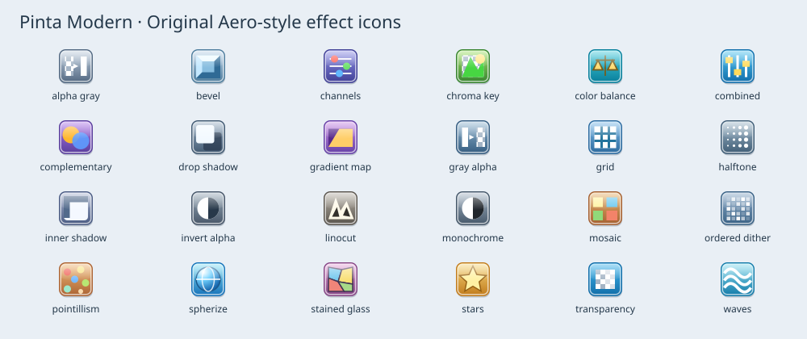

# Pinta Modern — development status

This is a fork of Pinta master at `b7f527a3d5f716b4f81903c39d5ea02579a5bd3b`, with an independently implemented interface and effects inspired by contemporary Paint.NET. It remains a GTK/.NET application on macOS, Linux and Windows. It is not a port of the proprietary modern Paint.NET engine or a loader for Paint.NET DLLs.

Reference checked on 10 November 2026: Paint.NET 5.1.12 stable and 5.2 Beta build 9793. This development version is **not a claim of complete visual or behavioral parity**. Interactive visual QA on the development Mac was blocked by computer-use access. The source builds; rendering and core tests are tracked below.

## Implemented interface

Traditional menu and two compact toolbars; a two-column Tools palette at the upper left; a persistent Colors palette at the lower left with primary/secondary swatches, HSV wheel, brightness, opacity, editable hex and palette swatches; History above Layers on the right. F5–F8 toggle these four palettes. C switches the active color and X swaps colors. The wheel supports right-button secondary-color selection and Ctrl/Alt/Shift constraints.

Effects → Effects Browser provides an icon-based, searchable list of registered effects and adjustments, including Pinta add-ins. Effects → Repeat Last Effect reuses the last successfully applied settings without opening the configuration dialog. Cancelled/failed renders do not replace the repeat cache.

## New effects

These are independent implementations of related operations, not copies of the named authors' code or exact replicas of their algorithms. Each effect has a dedicated original, editable Aero-style SVG icon, visible in the effect browser and history. The icon generator is `scripts/generate-modern-icons.py`.

| Menu | New effects |
| --- | --- |
| Adjustments | Transparency, Invert Alpha, Color Balance, Black and White Plus, Combined Adjustments |
| Color | Complementary Colors, Channel Mixer, Gradient Mapping, Ordered Dither |
| Object | Alpha to Gray, Gray to Alpha, Chroma Key, Bevel Object, Inner Shadow, Drop Shadow |
| Render | Grid / Checkerboard, Polygon / Stars |
| Artistic | Linocut, Mosaic, Pointillism, Stained Glass |
| Distort | Spherize, Waves |
| Stylize | Halftone |

Pinta already includes Feather Object, Outline Object, dithering, curves, blur, sharpening, vignette and many other effects. Existing registrations and attribution remain intact.

Alpha to Gray exports alpha as opaque gray; Gray to Alpha multiplies luminance by the existing alpha and produces a white mask. Linocut is a simple two-tone ink threshold. Mosaic supports square tiles and grout; Waves uses horizontal/vertical sinusoidal displacement; Halftone is monochrome. These do not reproduce all variants, GPU acceleration, color management or parameters in Paint.NET 5.2.



## Themes

Preferences → Custom Theme edits Background, Surface, Foreground, Accent, Border, Canvas and Selection. Values use `#RRGGBB`. Valid edits apply immediately; invalid values are marked and never injected into CSS. Import and export use JSON through native file dialogs. Light and dark presets are available; examples are in `themes/`.

The fork stores preferences separately in the `Pinta Modern` application-data directory. `PINTA_SETTINGS_DIRECTORY` can select an isolated profile for testing. Original Pinta preferences are not migrated or overwritten.

## Keyboard compatibility

`<Primary>` becomes Ctrl on Windows/Linux and Command on macOS. The built-in shortcut dialog displays the actual platform bindings. Existing Paint.NET-style tool letters and brush controls are retained, with forward/reverse tool cycling (S and Shift+S).

| Operation | Windows/Linux | macOS |
| --- | --- | --- |
| File new/open/save/save as/close | Ctrl+N/O/S/Shift+S/W | Cmd+N/O/S/Shift+S/W |
| Save all | Ctrl+Alt+S | Cmd+Option+S |
| Undo / redo | Ctrl+Z / Ctrl+Y | Cmd+Z / Cmd+Shift+Z |
| Copy merged | Ctrl+Shift+C | Cmd+Shift+C |
| Paste to new layer / image | Ctrl+Shift+V / Ctrl+Alt+V | Cmd+Shift+V / Cmd+Option+V |
| Select all / deselect / invert | Ctrl+A/D/I | Cmd+A/D/I |
| Crop / resize / canvas size | Ctrl+Shift+X / Ctrl+R / Ctrl+Shift+R | Cmd+Shift+X / Cmd+R / Cmd+Shift+R |
| Zoom to window / selection / actual size | Ctrl+B / Ctrl+Shift+B / Ctrl+0 | Cmd+B / Cmd+Shift+B / Cmd+0 |
| Rotate clockwise / counterclockwise | Ctrl+H / Ctrl+G | Cmd+Option+H / Cmd+G |
| New / duplicate / delete layer | Ctrl+Shift+N/D/Delete | Cmd+Shift+N/D/Delete |
| Merge down | Ctrl+M | Cmd+Option+M |
| Rotate / zoom layer | Ctrl+Shift+Z | Cmd+Option+Z |
| Toggle layer visibility | Ctrl+, | Cmd+, |
| Layer above / below | Alt+PageUp/PageDown | Option+PageUp/PageDown |
| Top / bottom layer | Ctrl+Alt+PageUp/PageDown | Cmd+Option+PageUp/PageDown |
| Next / previous image | Ctrl+PageDown/PageUp or Ctrl+Tab/Ctrl+Shift+Tab | Cmd+PageDown/PageUp or Ctrl+Tab/Ctrl+Shift+Tab |
| Select image 1–9 | Ctrl+1–9 or Alt+1–9 | Ctrl+1–9 or Option+1–9 |
| Properties / tools / history / layers / colors | F4/F5/F6/F7/F8 | Same (Fn may be needed) |
| Repeat last effect / effect browser | Ctrl+F / Ctrl+Alt+F | Cmd+F / Cmd+Option+F |
| Invert alpha | Ctrl+Alt+I | Cmd+Option+I |
| Preferences | Alt+X | Cmd+Option+, or Option+X |

Cmd+H and Cmd+M remain available to macOS. Native macOS redo is kept separate from Rotate/Zoom. The old conflicting shortcuts for Flip Layer and Actual Size were removed. Pinta's existing adjustment shortcuts remain available.

## Remaining parity work

The full Paint.NET keyboard/mouse reference has additional behavior that is not implemented here: clipboard selection serialization, window-position reset shortcuts, image-tab reordering, double-tap Home/End navigation and double-tap 90-degree rotation. Shape tools retain Pinta's separate tools rather than Paint.NET's unified Shapes selector. Printing/acquisition commands remain subject to Pinta's existing platform limitations. Exact text-tool, transform and mouse-modifier parity still needs interactive checking. This is **not yet all Paint.NET keybindings**.

The entire BoltBait pack is not reproduced. Specialized functions such as seam carving, calendar/chart rendering, text formations, meme composition, file/clipboard fills and selection-specific bevel/outline/shadow workflows remain outside this implementation. Broader packs such as pyrochild's Smudge/Liquify/Grid Warp are research references rather than claimed implemented features. Paint.NET plugin DLLs cannot be installed into this fork.

The workspaces and themes have not been visually accepted on macOS. Floating palettes currently have fixed anchor positions rather than Paint.NET's fully movable/translucent tool windows. High-precision HDR/WCG rendering, GPU effect execution and the new Paint.NET file-type API are not present.

## Build and verification

Requires .NET 10, GTK >= 4.18 and libadwaita >= 1.8; see the upstream README for installation. On the development Mac the SDK is local at `.dotnet` and native libraries are installed with Homebrew.

```sh
./scripts/run-macos.sh
```

For a regular SDK installation:

```sh
dotnet build Pinta.sln -p:BuildTranslations=true
LANG=en_US.UTF-8 LC_ALL=en_US.UTF-8 DYLD_LIBRARY_PATH=/opt/homebrew/lib dotnet test Pinta.sln --no-build
```

The non-C locale matters: GNU gettext deliberately does not translate in the C locale, so the upstream French-translation test fails with `LC_ALL=C.UTF-8` even when the `.mo` catalogs have been built.

Verified on the development Mac: solution build succeeds with zero warnings; 793 core tests and 174 effects tests pass. One pre-existing Voronoi test is skipped. The new coverage includes 53 effect tests and 12 theme/shortcut tests.

New tests exercise every added effect on partial-alpha inputs, 1×1 images, nonzero regions, split renders, immutable source buffers and premultiplied output. Further tests cover neutral adjustments, chroma key, alpha masks, cloned settings, theme validation/round trips and macOS shortcut alternatives.

## Research and attribution

- [Paint.NET official release blog](https://blog.paint.net/) — current stable/beta references and the eight effects introduced in 5.2.
- [Paint.NET main-window documentation](https://paint.net/doc/latest/MainWindow.html) — workspace reference.
- [Paint.NET keyboard/mouse reference](https://paint.net/doc/latest/KeyboardMouseCommands.html) — command mapping reference.
- [BoltBait plugin pack](https://www.boltbait.com/pdn/) — related color, alpha, object and render operations.
- [Paint.NET plugin packs](https://forums.paint.net/forum/44-plugin-packs/) — additional plugin discovery.
- [pyrochild plugin pack](https://forums.paint.net/topic/7291-pyrochild-plugins-2026-10-04/) — Gradient Mapping and other research candidates.
- [Modify Channels](https://forums.paint.net/topic/110805-modify-channels-v111-2022-03-07/) — channel-operation reference.
- [Paint.NET licensing](https://paint.net/license.html) — modern application binaries are not reused.

Pinta's MIT license and historical Paint.NET 3.36 notices remain in force. All new code and SVG assets in this fork use the project's MIT license. The upstream project does not accept substantial AI-generated code contributions; this work is maintained in the user's independent fork, not submitted upstream.
