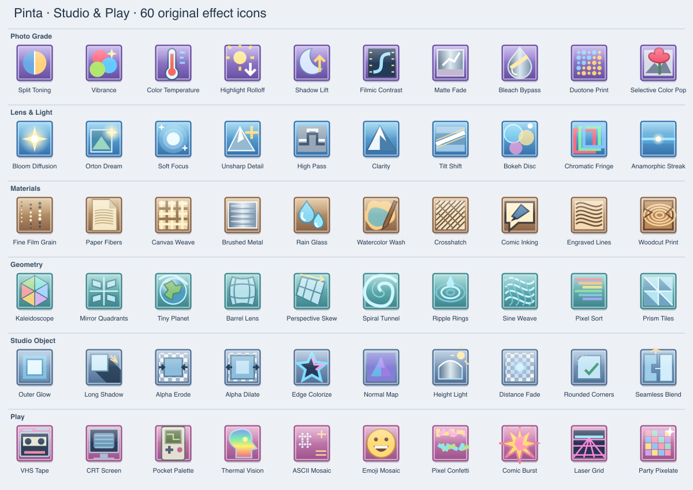

# Studio & Play — 60 nieuwe effecten

Alle onderstaande effecten zijn nieuw ten opzichte van de eerdere 24 toevoegingen. Het zijn ingebouwde Pinta-effecten met live preview, undo en eigen instelbare parameters. De term Studio duidt op het creatieve pakket; er is geen betaalmuur.

| # | Effect | Groep | Functie |
| --- | --- | --- | --- |
| 1 | Split Toning | Photo Grade | Warm highlights and cool shadows with a smooth luminance-dependent tint. |
| 2 | Vibrance | Photo Grade | Boost muted colors while protecting already saturated colors and skin-like tones. |
| 3 | Color Temperature | Photo Grade | Warm or cool the image while compensating for changes in brightness. |
| 4 | Highlight Rolloff | Photo Grade | Soften bright highlights with a smooth shoulder curve; this does not recover clipped RAW data. |
| 5 | Shadow Lift | Photo Grade | Open dark areas with a smooth shadow-weighted lift. |
| 6 | Filmic Contrast | Photo Grade | Apply a normalized cinematic S-curve with controlled contrast. |
| 7 | Matte Fade | Photo Grade | Lift the black point and gently soften whites for a matte print finish. |
| 8 | Bleach Bypass | Photo Grade | Combine reduced saturation with punchy silver-retention-style contrast. |
| 9 | Duotone Print | Photo Grade | Render a two-ink ordered print using your two chosen colors. |
| 10 | Selective Color Pop | Photo Grade | Keep hues near the first chosen color and turn the remaining image monochrome. |
| 11 | Bloom Diffusion | Lens & Light | Spread bright highlights into a soft, threshold-controlled glow. |
| 12 | Orton Dream | Lens & Light | Layer a diffused screen-and-multiply treatment over the original photo. |
| 13 | Soft Focus | Lens & Light | Blend a smooth, alpha-aware diffusion layer into fine detail. |
| 14 | Unsharp Detail | Lens & Light | Add crisp detail using the difference between the original and its blurred image. |
| 15 | High Pass | Lens & Light | Extract a neutral-gray high-pass detail map for texture and retouching work. |
| 16 | Clarity | Lens & Light | Enhance local luminance contrast without applying a global contrast curve. |
| 17 | Tilt Shift | Lens & Light | Keep an angled focus band sharp while diffusing the foreground and distance. |
| 18 | Bokeh Disc | Lens & Light | Use a sampled circular aperture with highlight weighting for a defocused look. |
| 19 | Chromatic Fringe | Lens & Light | Separate red and blue radially to simulate lens color fringing. |
| 20 | Anamorphic Streak | Lens & Light | Stretch bright points into horizontal lens-like light streaks. |
| 21 | Fine Film Grain | Materials | Add reproducible luminance-weighted fine grain with a selectable seed. |
| 22 | Paper Fibers | Materials | Add a softly tinted paper surface with irregular directional fibers. |
| 23 | Canvas Weave | Materials | Emboss an alternating woven thread pattern into the image. |
| 24 | Brushed Metal | Materials | Generate a tinted metal surface with directional grain and a broad reflection. |
| 25 | Rain Glass | Materials | Refract the image through seeded glass droplets with small specular highlights. |
| 26 | Watercolor Wash | Materials | Choose low-variance neighborhood washes and add a restrained paper tooth. |
| 27 | Crosshatch | Materials | Build layered diagonal ink hatching according to local brightness. |
| 28 | Comic Inking | Materials | Combine quantized color with luminance edges for an inked comic treatment. |
| 29 | Engraved Lines | Materials | Convert tone into flowing engraved strokes of varying thickness. |
| 30 | Woodcut Print | Materials | Combine carved contours, coarse tonal bands and deterministic wood grain. |
| 31 | Kaleidoscope | Geometry | Fold the image into mirrored radial segments. Scale controls the segment count. |
| 32 | Mirror Quadrants | Geometry | Reflect the lower-right part of the image across the two center axes. |
| 33 | Tiny Planet | Geometry | Wrap a panorama into a stereographic-style little planet. Scale controls zoom. |
| 34 | Barrel Lens | Geometry | Introduce a radial barrel-lens distortion around the image center. |
| 35 | Perspective Skew | Geometry | Apply a controllable keystone and slanted perspective remapping. |
| 36 | Spiral Tunnel | Geometry | Repeat the image through a logarithmic spiral tunnel. |
| 37 | Ripple Rings | Geometry | Displace the image with concentric radial ripples. |
| 38 | Sine Weave | Geometry | Interweave two modulated displacement fields into a flowing mesh. |
| 39 | Pixel Sort | Geometry | Sort bright opaque runs by luminance inside bounded horizontal spans. |
| 40 | Prism Tiles | Geometry | Fold each square tile across its diagonal into mirrored triangular prisms. |
| 41 | Outer Glow | Studio Object | Place a colored soft halo behind the nontransparent parts of the layer. |
| 42 | Long Shadow | Studio Object | Cast a directional, fading silhouette shadow behind an object. |
| 43 | Alpha Erode | Studio Object | Shrink opaque areas using a separable minimum-alpha filter. |
| 44 | Alpha Dilate | Studio Object | Expand alpha coverage and extend neighboring object color into the new edge. |
| 45 | Edge Colorize | Studio Object | Turn luminance contours into a two-color glowing edge treatment. |
| 46 | Normal Map | Studio Object | Convert luminance slopes into a tangent-space RGB normal map. |
| 47 | Height Light | Studio Object | Shade luminance as a height surface using an angled virtual light. |
| 48 | Distance Fade | Studio Object | Fade alpha smoothly toward the outer edges of the layer. |
| 49 | Rounded Corners | Studio Object | Cut antialiased rounded corners into the layer alpha. |
| 50 | Seamless Blend | Studio Object | Blend opposite edges symmetrically to soften texture tiling seams. |
| 51 | VHS Tape | Play | Add seeded tracking jitter, color lag, scan lines and occasional tape scratches. |
| 52 | CRT Screen | Play | Simulate a curved phosphor screen with RGB subpixels, scan lines and edge falloff. |
| 53 | Pocket Palette | Play | Average pixels into a four-green handheld-console palette with ordered dithering. |
| 54 | Thermal Vision | Play | Map image brightness into a dramatic multicolor heat display. |
| 55 | ASCII Mosaic | Play | Build an image from ten tiny bitmap glyphs using two chosen colors. |
| 56 | Emoji Mosaic | Play | Turn image cells into small happy, sad or surprised illustrated faces. |
| 57 | Pixel Confetti | Play | Scatter deterministic colorful paper slips over the image or a transparent canvas. |
| 58 | Comic Burst | Play | Add a two-color comic-book radial burst that leaves a calmer center. |
| 59 | Laser Grid | Play | Generate a retro perspective laser floor with a glowing horizon. |
| 60 | Party Pixelate | Play | Turn averaged image blocks into a seeded party of shifting hue families. |

## Gebruik en instellingen

Open **Effects → Effects Browser** en zoek op naam, groep of beschrijving. De zes groepen staan ook direct in het Effects-menu. Elk effect opent een eigen configuratie met live preview; OK past het resultaat toe via de normale undo-geschiedenis. Repeat Last Effect herhaalt de laatst bevestigde instellingen.

Alle effecten hebben Strength (0–100%); 0% bewaart de oorspronkelijke pixels exact. Alleen toepasselijke parameters zijn zichtbaar: Radius (1–64 px), Scale (2–128), Angle (−180–180°), Detail (0–100), Seed (0–65535) en één of twee kleuren. Detail 50 is de neutrale temperatuur bij Color Temperature; lager koelt, hoger verwarmt. Seed maakt ruis en decoratie reproduceerbaar. Voor spiegels en vervormingen staat Strength standaard op 100% om dubbele contouren te vermijden.

Outer Glow en Long Shadow werken achter de bestaande alpha: gebruik een object op een transparante laag. Normal Map gebruikt helderheid als hoogte. Seamless Blend maakt tegengestelde canvasranden gelijk bij 100%. Laser Grid en Brushed Metal kunnen ook een lege laag vullen; Comic Burst en Pixel Confetti voegen decoratie toe. Zet hun Strength hoger voor een sterker resultaat.

## Beelden

Elk effect heeft een eigen origineel SVG-icoon en een aparte 64×64 PNG. De vierkante tegels gebruiken gekleurde Windows 7/Aero-achtige randen en highlights. De app laadt de losse afbeeldingen; de spritesheet is een overzicht en exportatlas.

- SVG: `Pinta.Resources/icons/hicolor/scalable/actions/pinta-studio-*.svg`
- PNG: `Pinta.Resources/icons/hicolor/64x64/actions/pinta-studio-*.png`
- Atlas: `docs/assets/studio-spritesheet.json` (celcoördinaten, ID en bestandsnaam)
- Genereren: `python3 scripts/generate-studio-pack.py` en `python3 scripts/generate-studio-icons.py` (PNG-export vereist librsvg).

## Werkelijke voorbeeldrenders reproduceren

`dotnet run --project tests/Pinta.StudioPreview` schrijft een origineel testbeeld plus 60 daadwerkelijk gerenderde PNG-bestanden naar `artifacts/studio-previews/`. `python3 scripts/render-studio-previews.py` maakt zes contactbladen met het origineel ernaast. Dit zijn resultaten van de effectkernels, geen screenshots van de app.

## Inspiratie en grenzen

Algemene bewerkingsideeën zijn onderzocht bij [BoltBait](https://www.boltbait.com/pdn/), het [community-overzicht](https://forums.paint.net/forum/44-plugin-packs/), [pyrochild](https://forums.paint.net/topic/7291-pyrochild-plugins-2026-10-04/) en [Koh](https://forums.paint.net/topic/132885-kohs-gpu-effects-source-code-preview-update-2026-09-10/). De kernels, parameters, bitmapglyphs en iconen zijn zelfstandig gemaakt onder de MIT-licentie van deze fork. Namen zoals Bloom, High Pass en Pixel Sort beschrijven algemene beeldbewerkingen; er is geen claim op dezelfde algoritmen of uitvoer als een specifiek communitypakket.

Dit zijn 60 ingebouwde, configureerbare effecten; er is geen betaalmuur en er worden geen Paint.NET-plugin-DLL’s geladen. De verwerking gebruikt Pinta’s bestaande 8-bit premultiplied RGBA-pijplijn op de CPU. Bloom en soft focus gebruiken een drie-pass boxblur-benadering; Bokeh Disc gebruikt 24 apertuursamples; Watercolor Wash gebruikt een compacte minimumvariantie-filter met papierkorrel. Er is geen GPU/HDR/RAW-engine. Interactieve visuele controle van de volledige app op macOS blijft apart van de geslaagde render- en widgettests.
