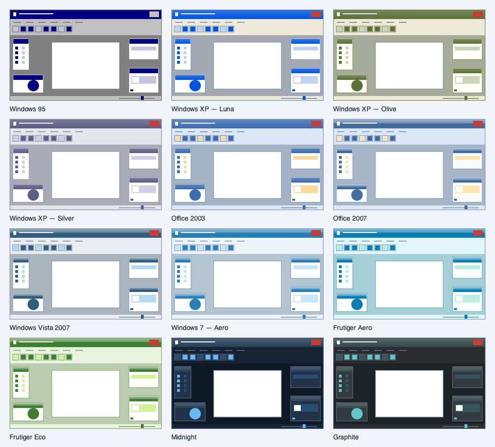

# 12 kant-en-klare thema’s

Open **Preferences → Themes** (Instellingen → Thema’s). De galerij toont 12 klikbare voorbeelden. Een klik activeert het gekozen thema direct; de zeven kleurvelden eronder blijven bewerkbaar. Import en export bewaren zowel de kleuren als de gekozen afwerking. Bestaande JSON-thema’s met alleen zeven kleurvelden blijven werken.

| Thema | Afwerking | Importbestand |
| --- | --- | --- |
| Windows 95 | Marineblauwe titelbalken, grijs en klassieke reliëfranden | [JSON](../themes/presets/windows-95.json) |
| Windows XP — Luna | Crème vlakken, blauwe Luna-balken en oranje sluitknop | [JSON](../themes/presets/xp-luna.json) |
| Windows XP — Olive | Olijfgroene Luna-balken en beige bediening | [JSON](../themes/presets/xp-olive.json) |
| Windows XP — Silver | Zilver/lila Luna-balken en violette selectie | [JSON](../themes/presets/xp-silver.json) |
| Office 2003 | Blauwe werkbalken, oranje selectie en hover | [JSON](../themes/presets/office-2003.json) |
| Office 2007 | Lichtblauwe glansbanden en gouden selectie | [JSON](../themes/presets/office-2007.json) |
| Windows Vista 2007 | Rokerig blauwe Aero-afwerking | [JSON](../themes/presets/vista-2007.json) |
| Windows 7 — Aero | Heldere blauwe Aero-balken en lichte vlakken | [JSON](../themes/presets/windows-7.json) |
| Frutiger Aero | Glanzend aquablauw met frisse cyaanvlakken | [JSON](../themes/presets/frutiger-aero.json) |
| Frutiger Eco | Bladgroene glans en lichte mint-/natuurtinten | [JSON](../themes/presets/frutiger-eco.json) |
| Midnight | Diep marineblauw met koelblauwe accenten | [JSON](../themes/presets/midnight.json) |
| Graphite | Neutraal antraciet met turquoise accenten | [JSON](../themes/presets/graphite.json) |



De voorbeelden hierboven komen uit dezelfde tekenfunctie als de ingebouwde galerij; het zijn verkleinde schematische previews, geen screenshots van de volledige app. De thema’s zijn zelfstandig gemaakte interpretaties van deze stijlen. Aero/Frutiger gebruiken glansgradients en schaduwen, geen echte achtergrondvervaging of overgenomen Windows-afbeeldingen. De plaatsing en werking van tools, documenten, lagen en effecten veranderen niet.

De standaard lichte/donkere knoppen en import/export blijven beschikbaar. Bij het wijzigen van kleuren blijft de gekozen afwerking behouden; de galerij deselecteert een preset zodra de kleurcombinatie daarvan afwijkt. Zo wordt een aangepast thema niet onterecht als een ongewijzigd preset aangegeven.

## Ontwikkeling en controle

`Pinta.Core/Classes/ThemePresets.cs` is de bron voor de 12 presets. `ThemePalette.Style` selecteert een begrensde `ThemeStyle` enum; de stylesheet gebruikt uitsluitend vaste codefragmenten en gevalideerde hexkleuren. Oude thema-JSON zonder Style krijgt automatisch de bestaande Windows10-afwerking. Onbekende numerieke styles worden afgewezen.

Exporteer de importbestanden, losse previews en de galerij opnieuw met:

```sh
LANG=en_US.UTF-8 LC_ALL=en_US.UTF-8 DYLD_LIBRARY_PATH=/opt/homebrew/lib dotnet run --project tests/Pinta.UiSmoke -- --export-themes themes/presets
```

De galerij gebruikt logische pixels, vectorpreviewtekeningen en een FlowBox die bij kleinere vensters van drie naar twee of één kolom gaat. Coretests dekken export/import van de afwerking, het bewerken van kleuren, oude JSON-bestanden en ongeldige styles. Widgetchecks bouwen alle 12 kaarten en laten GTK de CSS van alle presets controleren.
