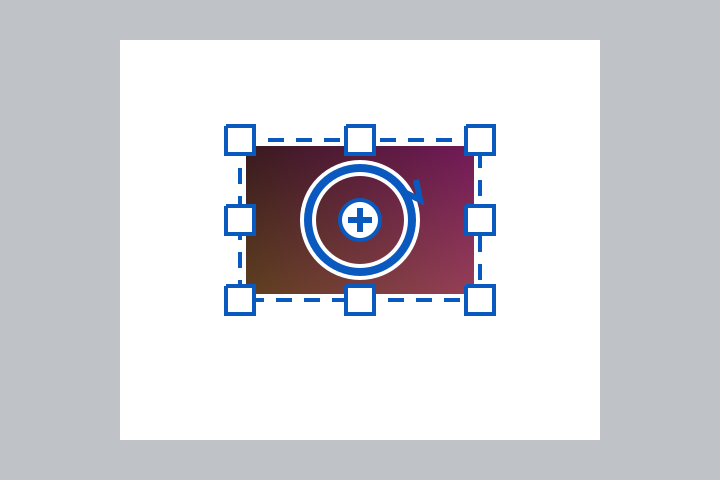

# Afbeelding draaien met grepen

Kies **Move Selected Pixels** (`M`) om geselecteerde pixels of de actieve laag te bewerken. Zonder expliciete selectie geldt de hele afbeelding van de actieve laag. Een geplakte afbeelding gebruikt dezelfde tool en bediening. **Move Selection** (`Shift+M` of de volgende tool in de M-groep) past alleen de selectieomtrek aan.

| Bediening | Resultaat |
| --- | --- |
| Binnen de selectie slepen | Verplaatsen |
| Vierkante hoek- of randgreep slepen | Formaat aanpassen |
| Vlak buiten een hoek/rand slepen | Draaien rond het draaipunt |
| Buitenste ring van de middelste cirkel slepen | Draaien rond het draaipunt |
| Kruisje binnen de middelste cirkel slepen | Draaipunt verplaatsen; wijzigt geen pixels |
| Shift tijdens draaien | Absolute hoek vastzetten op veelvouden van 15° |
| Shift tijdens schalen | Verhouding behouden |
| Alt/Option tijdens schalen met een greep | Schalen vanuit het midden |
| Rechts slepen | Draaien, ook zonder een greep te raken |
| Ctrl/Command binnen de selectie slepen | Bestaande schaalbediening behouden |
| Pijltjestoetsen; Ctrl/Command+pijltjes | Verplaatsen met 1 respectievelijk 10 pixels |
| Reset Pivot in de toolbalk | Draaipunt terug naar het midden |

De kadergrepen draaien en schalen mee met de afbeelding. Het draaipunt mag in de grijze werkruimte buiten het canvas liggen. Grepen en trefzones gebruiken logische schermpixels: ze blijven even groot wanneer de afbeelding wordt in- of uitgezoomd en GTK verzorgt de HiDPI-schaling. De statusbalk toont de actuele hoek tijdens rotatie.



Dit is een vergrote render van de daadwerkelijke grepen, geen screenshot van het volledige appvenster. De standaardbediening voor het kader, de buitenste draaizone en het verplaatsbare draaipunt is geïnspireerd op de [officiële Paint.NET Move Tools-documentatie](https://paint.net/doc/latest/MoveTools.html). De centrale buitenring is een aanvullende directe draaigreep voor deze fork.

## Implementatie

`TransformFrame` bewaart een georiënteerd kader. Het kader en draaipunt zijn waardedata in `DocumentSelection` en gaan mee in bestaande clone- en undo-snapshots. Willekeurige selectieaanpassingen wissen verouderde transformmetadata. `BaseTransformTool` gebruikt de bestaande pixel-/selectietransformaties en geschiedenis. Een losse klik maakt geen pixelbewerking of history-item. Het verplaatsen van alleen het draaipunt is UI-state. Het canvasformaat verandert niet; vastleggen blijft de bestaande selectie-/laagworkflow gebruiken.

`TransformGizmoHandle` tekent via de bestaande GSK-handle-interface. De nieuwe overlay-handlevariant wordt door `CanvasWindow` over de viewport getekend, zodat de bediening buiten de afbeeldingsrand zichtbaar blijft. Andere tools behouden hun bestaande manier van tekenen.

## Verificatie

- Coretests: rotatie, alle acht ankers, schalen van een al gedraaid kader, proporties/centrum, spiegelen, bescherming tegen nulschaling, 15°-snap, zoomonafhankelijke trefzones en onafhankelijke selectiesnapshots.
- `tests/Pinta.TransformSmoke`: echte muisdispatch naar beide tools met documenten, pixels en geschiedenis. Controleert onder andere exacte pixels bij 90°-rotatie, undo/redo, de centrale ring, een extern draaipunt, achtereenvolgende transformaties, snelle drags, toetsen/modifiers, toolwissels en het native tekenen van de grepen. Geen vensters of desktopinput worden gebruikt.

```sh
LANG=en_US.UTF-8 LC_ALL=en_US.UTF-8 DYLD_LIBRARY_PATH=/opt/homebrew/lib dotnet run --project tests/Pinta.TransformSmoke
```
